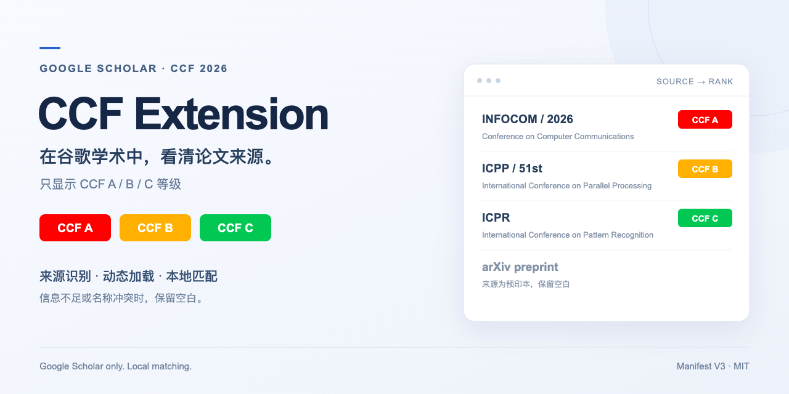
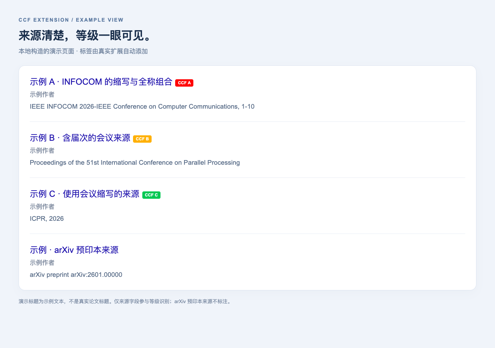

<p align="center">
  
</p>

<p align="center">
  <strong>在谷歌学术中查看论文来源的 CCF 等级。</strong><br>
  内置 CCF 2026 第七版目录 · 本地匹配 · 刷新与下滑自动标注
</p>

<p align="center">
  <a href="https://github.com/Whelve-Autism/CCF-Extension/archive/refs/heads/main.zip">下载源码</a> ·
  <a href="#安装">安装方法</a> ·
  <a href="https://github.com/Whelve-Autism/CCF-Extension/issues">反馈漏标或误标</a> ·
  <a href="LICENSE">MIT License</a>
</p>

## 功能

- **只标注 CCF A / B / C**：A 类红色、B 类橙黄色、C 类绿色；非 CCF 来源不显示标签。
- **自动更新**：覆盖搜索结果、作者主页和论文详情；刷新、下滑或“显示更多”载入新内容后自动识别。
- **适应常见来源写法**：支持全称、缩写、部分单词简写与信息充分的截断名称，处理年份、会议届次及 Proceedings / Proc. 等前缀。
- **优先避免误标**：组合名称必须相互一致；来源明确为 arXiv、CoRR、Findings 或附属 Workshop 等时不继承主会等级。CCF 单独收录的 Workshop 按其自身条目识别。
- **本地处理**：识别逻辑和目录均随扩展提供，匹配过程不上传页面内容，也不调用外部查询接口。

## 效果预览



上图由实际加载的扩展在本地构造页面中生成，条目标题为演示文本。标签由扩展根据来源字段自动添加。

## 安装

普通使用者无需安装 Node.js、Python，也不需要运行命令。

1. 点击 **[下载源码 ZIP](https://github.com/Whelve-Autism/CCF-Extension/archive/refs/heads/main.zip)**，解压到一个准备长期保留的位置。
2. 打开 Chrome 的扩展管理页：在地址栏输入 **chrome://extensions**。Edge 用户可打开 **edge://extensions**。
3. 开启 **开发者模式**，点击 **加载已解压的扩展程序**。
4. 选择**直接包含 manifest.json 的文件夹**。从 GitHub 下载后，通常是解压得到的 `CCF-Extension-main` 文件夹。
5. 打开或刷新谷歌学术。识别成功后，论文标题旁会出现 CCF 标签；悬停可查看对应的目录名称。

请选择解压后的文件夹，不要选择 ZIP 文件或它的上一层目录。加载后保留该文件夹，移动或删除它会影响扩展运行。

更新时，用新版文件替换原目录内容，在扩展管理页点击 **重新加载**，然后刷新谷歌学术。

安装方式可参考 [Chrome 官方说明](https://developer.chrome.com/docs/extensions/get-started/tutorial/hello-world#load-unpacked)。

## 兼容性与识别范围

| 环境 | 当前验证情况 |
| --- | --- |
| macOS + Chrome | 已完成实际扩展加载与模拟学术页面交互测试，用户已验证日常使用 |
| Windows + 新版 Chrome | 代码和资源路径已检查；尚未进行 Windows 实机测试 |
| 新版 Microsoft Edge | 按 Chromium 扩展兼容性预期可用；尚未实机测试 |

同一份源码包适用于上述 Chrome 环境，无需按操作系统修改代码。Edge 的兼容性依据见 [微软官方说明](https://learn.microsoft.com/en-us/microsoft-edge/extensions/developer-guide/port-chrome-extension)。

扩展仅在清单列出的 **Google Scholar 官方域名**运行；普通 Google 搜索和第三方学术镜像不在识别范围内。浏览器须能正常访问谷歌学术。

所有论文均按**内置的 CCF 2026 目录**标注，论文发表年份只用于清理来源名称，不用于查找历史等级。目录随扩展版本更新，不自动在线同步。

## 为什么有些条目没有标签？

未标注不一定代表“非 CCF”。以下情况会保留空白：

- 来源字段缺失、被截断得过短，或缩写无法唯一确定会刊。
- 来源属于预印本、附属活动，或未被当前目录收录。
- 缩写与全称相互冲突，或写法尚未被覆盖。

识别依据是谷歌学术的**来源字段**，不会从论文标题、摘要或下载链接猜测会刊。标签表示该来源对应的目录等级，最终以 [CCF 官方目录](https://www.ccf.org.cn/Academic_Evaluation/By_category/)和实际出版记录为准。

发现问题时，请在 [Issues](https://github.com/Whelve-Autism/CCF-Extension/issues) 提供：**完整来源文本、预期等级、页面类型、浏览器与扩展版本**，能附截图更方便复现。

<details>
<summary><strong>开发与验证</strong></summary>

当前扩展版本为 **4.8.4**。该版本已通过 **191 项自动化测试**，并完成 Chrome 实际加载扩展、动态更新、刷新及作者主页等模拟页面检查；这不等同于 Windows 实机测试。

在已安装 Node.js 的环境中运行识别测试：

```sh
node --test test/ccf.test.cjs
```

`test/browser.cjs` 与 `test/extension.cjs` 提供浏览器检查，需要另外准备 Playwright 和对应浏览器。`CCF_CHROME_PATH`、`CCF_CHROMIUM_PATH` 分别用于指定其浏览器路径。

使用 Python 标准库生成精简分享包：

```sh
python3 tools/build.py
```

Windows 也可以使用 `py tools/build.py`。输出位于项目目录的上一层，名称为 `CCF_Extension.zip`；首页说明与展示图片不进入这个分享包。

4.8.4 修复了 SECON 等会议“年份＋届次＋Annual”及其截断来源的识别，并支持“研讨会论文”“会议名称”等详情页来源字段。Annual 本就属于正式名称的会议仍保留原名参与匹配。

4.8.3 补充了 INFOCOM 出版名称别名，以及“缩写＋年份＋连接号／括号＋全称”的组合识别，并保留名称冲突、预印本和附属活动的排除检查。

</details>

## 目录来源与致谢

等级依据为 [中国计算机学会推荐国际学术会议和期刊目录，第七版（2026）](https://www.ccf.org.cn/Academic_Evaluation/By_category/)。本项目是社区维护的辅助工具。

项目基于 [CCFrank4dblp](https://github.com/WenyanLiu/CCFrank4dblp) 整理和定制，保留原项目的 [MIT 许可证](LICENSE)及版权声明。感谢原项目维护者和贡献者。
